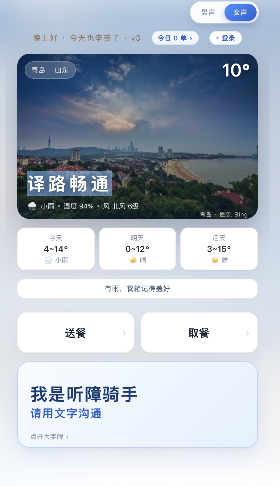

# 译路畅通 SilentRider
## 项目介绍与使用说明

> 版本：v1.0.0 · 2026-11-08  
> 团队：@hejioxue、@IREXS-JPG、@NikaL-Li

---

## 一、项目一句话

**译路畅通（SilentRider）是为听障配送骑手打造的无障碍沟通工具。**  
内置取餐、送餐场景预设话术，支持文字转语音、大字举牌展示，帮助骑手无需通话，和商家、顾客顺畅沟通。

在线体验：<https://ylct.lzc2006.cn/>



> **评委速览**：真实公益痛点（听障骑手电话沟通）→ 一个手机网页完成“听、说、举牌” → 截图一次可同时解析取货/送货两端 → 腾讯云 OCR + MiMo TTS + 高德 + PWA → 已上线、可运行、48 项后端测试通过。

---

## 二、为什么做这个项目

配送骑手每天要打很多电话：确认楼栋、找门禁、请人按电梯、解释“我是听障骑手”。
对听障骑手来说，电话不是沟通，而是障碍。

译路畅通把现场沟通拆成三种方式：

1. **听对方说**：语音识别转成大字；
2. **替我说**：点一句预设话术，语音念给对方听；
3. **举牌**：说不清时，把手机屏幕直接举给对方看。

目标不是替代配送平台，而是补上“最后十米”的沟通环节。

---

## 三、适用场景

- 听障外卖/跑腿/快递骑手；
- 门禁、前台、电梯、商场等需要和保安/顾客短句沟通的场景；
- 电话不方便外放、环境嘈杂、对方听不清的普通骑手；
- 需要把地址、取餐码、手机尾号准确传达给商家的场景。

---

## 四、核心功能

| 模块 | 能力 |
|---|---|
| 听对方说 | 浏览器语音识别，实时转成大字 |
| 替我说 | 取餐/送餐预设话术，点击播放 |
| 大字牌 | 全屏高对比大字，适合门禁、前台、电梯 |
| 地址 | 小区、楼栋、房号、楼层；历史地址补全 |
| 取餐 | 商家、取货地址、手机尾号、取餐码 |
| 截图识别 | 订单截图 OCR，自动解析取货/送货地址 |
| 双地址 | 上面取货、下面送货；多单只取最上面一单 |
| 记录 | 今日、近 7 天、本月、今年；近 30 天 |
| 天气/壁纸 | 高德定位 + 天气；每日 5 张城市壁纸 |
| 电话 | 免提外放、音量增强；外呼接口预留 |
| 多用户 | 未登录可用；登录后记录/地址簿云同步 |
| PWA | 可添加到主屏幕，弱网/离线可用 |

### 一张截图，两端同步（重点能力）

真实订单截图经常在一张卡里同时出现两个地址。系统按行块自动拆分：

- **第一段地址 → 取货地址**，进入取餐页；
- **第二段地址 → 送货地址**，进入送餐页；
- 一张截图有多张订单卡时，只取**最上面一单**，避免两单地址混在一起；
- 取餐手机尾号/取餐码自动同步到送餐对话；
- `A栋15楼` 自动拆成楼栋 `A栋`、楼层 `15`；
- 识别不出来时可粘贴文字兜底，所有字段仍可手动修正。

这使骑手从“分别填取餐、送餐两套信息”变成“一次截图，两端同步”。

### AI 技术栈与优势

| 能力 | 技术 | 优势 |
|---|---|---|
| 听对方说 | Web Speech API | 低延迟、无额外识别费用；不支持时可直接打字 |
| 替我说 | MiMo TTS | 男/女声、数字读法、服务端 Key；失败回退浏览器语音 |
| 截图识别 | 腾讯云 OCR `RecognizeAgent` | 云端主识别；1800px/JPEG 90，约 150KB；实测约 1.3s；失败回退本地 Tesseract |
| 地址理解 | 规则 + 行块解析 | 双地址、多单首单、A栋/楼层、取餐码/手机号纠错 |
| 定位/天气 | 高德 Web 服务 | IP/浏览器定位、逆地理、实时天气 + 3 天预报 |
| 城市壁纸 | Bing 图片代理 | 按城市/日期缓存 5 张，失败保留内置图 |
| 数据层 | SQLite | 单文件、零第三方运行时依赖，部署成本低 |
| 交付 | PWA + Cloudflare Tunnel | 免安装、弱网可用、HTTPS 上线 |

**效率与可推广性**

- 截图上传前压缩到 1800px/约 150KB，减少移动网络等待；
- 云 OCR 实测约 1.3 秒，本地 Tesseract 兜底避免云服务不可用中断；
- 前端单文件、无构建步骤，后端 Python 标准库，普通云主机可部署；
- 不登录也能用，登录后云同步；PWA 可添加到主屏幕；
- 48 项后端回归测试通过，线上地址可直接体验。

### 对应评审维度

| 评审关注点 | 本项目的对应证据 |
|---|---|
| 业务洞察与问题拆解 | 聚焦听障骑手“电话沟通”这一高频、刚性、被忽视的痛点；把沟通拆成听、说、举牌 |
| 提效成果与可推广性 | 免通话、三步完成；一张截图两端同步；PWA 免安装；普通云主机可复制部署 |
| 任务完成度 | 已上线可运行；注册/登录、地址、取餐、对话、记录、OCR、天气/壁纸、电话外放均有实现；48 项测试 |
| 系统集成与 AI 运用 | Web Speech + MiMo TTS + 腾讯云 OCR + 高德 + Bing + SQLite + PWA，多能力串成完整工作流 |
| AI 原生创新性 | 不是单点聊天，而是多模态输入（截图/语音/文字）+ 场景话术 + 双地址结构化 + 无障碍交互 |

---

## 五、使用说明

### 1. 打开与安装

- 手机浏览器打开：<https://ylct.lzc2006.cn/>
- iPhone：Safari → 分享 → 添加到主屏幕
- Android：Chrome → 菜单 → 添加到主屏幕
- 不登录也能使用；登录后订单记录和地址簿会同步到云端

### 2. 首页

- 首次打开会请求定位，用于显示城市、天气和城市壁纸；
- 首页显示今天/明天/后天天气；
- 选择 **送餐** 或 **取餐** 进入对应流程；
- 需要出示身份时，点「我是听障骑手」大字牌。

### 3. 送餐地址

1. 填小区名称；
2. 填楼栋、房号；
3. 选楼层（10 层以上在输入框填写）；
4. 需要导航时点「导航」，跳转手机地图；
5. 订单截图可直接点「截图识别订单」自动填写；
6. 识别失败时可用「粘贴识别」兜底；
7. 点「进对话」。

### 4. 取餐信息

1. 填商家名称；
2. 填取货地址（选填）；
3. 填手机尾号、取餐码；
4. 可点「截图识别订单」从截图自动填；
5. 点「进对话」，取餐信息会同步到送餐对话。

### 5. 对话页

- **听对方说**：点麦克风，对方说话会变成大字；
- **替我说**：点预设话术，手机会替骑手播报；
- **再补一句**：根据上一句给出跟进话术；
- **我自己说**：输入文字后播报；
- **大字牌**：全屏展示“我是听障骑手”；
- **电话**：免提外放，适合现场沟通；
- **这单送完了**：记录一单，显示今日战绩和下一档鼓励。

### 6. 送餐记录

- 首页「今日 x 单」进入记录页；
- 查看今日、近 7 天、本月、今年；
- 近 30 天每日记录；
- 登录后云端同步，换手机不丢。

### 7. 账号

- 手机号 + 密码注册/登录；
- 未登录数据只存在本机；
- 登录后地址簿、订单记录同步；
- 忘记密码可在账号页按提示重置。

### 8. 隐私提醒

- 订单截图包含手机号、地址等隐私信息；
- 使用截图识别时，图片会发送到 OCR 服务商；
- 不要把包含真实用户信息的截图发到公开群/仓库；
- 生产环境应准备隐私说明并允许用户选择本地 OCR。

---

## 六、技术与部署

- 前端：单文件 `index.html`（原生 HTML/CSS/JS）+ PWA；
- 后端：Python 3.10 标准库，零第三方运行时依赖；
- 数据库：SQLite；
- 定位/天气：高德 Web 服务 API；
- OCR：腾讯云 `RecognizeAgent` 优先，本地 Tesseract 兜底；
- 壁纸：Bing 图片代理，按城市/日期缓存；
- 部署：Ubuntu + systemd + Nginx + Cloudflare Tunnel。

```text
浏览器 / PWA
   │ HTTPS
   ▼
Cloudflare ──► Tunnel ──► Python stdlib server
                              ├── SQLite
                              ├── 高德 Web 服务
                              ├── 腾讯云 OCR
                              ├── 本地 Tesseract（兜底）
                              └── Bing 图片代理
```

---

## 七、三人协作与工作流程

### 版本接力

```text
@hejioxue v0.1.0  →  @IREXS-JPG v0.1.2  →  @NikaL-Li v0.1.3  →  Team v1.0.0
初始「传声」原型     模型/音色/数字读法     产品化整合          合并/测试/发布
```

| 版本 | 成员 | GitHub | 主要工作 |
|---|---|---|---|
| v0.1.0 | @hejioxue | [@hejioxue](https://github.com/hejioxue) | 首个可运行「传声」原型：语音识别、话术、TTS、大字牌、演示 |
| v0.1.2 | @IREXS-JPG | [@IREXS-JPG](https://github.com/IREXS-JPG) | 模型接入与音色选型、数字读法规则多轮迭代、男/女声切换、端口占用修复 |
| v0.1.3 | @NikaL-Li | [@NikaL-Li](https://github.com/NikaL-Li) | 登录/多用户、订单记录、地址簿、高德/壁纸、OCR、双地址、部署、UI 收敛 |
| v1.0.0 | 三人团队 | — | 合并、音频竞态修复、文档、测试、正式发布 |

### 协作方式

1. **按版本交接**：每位成员在上一版基础上完成自己的工作，保留可运行快照；
2. **写清改动**：每个版本在 CHANGELOG / Release 中记录做了什么、为什么做；
3. **按人提交**：Git 历史保留真实作者，v1.0.0 用 `Co-authored-by` 标注三人；
4. **统一验收**：最后由@NikaL-Li负责集成、回归测试、部署和文档；
5. **可追溯**：GitHub tags / Releases 对应四个版本，方便回看每一步。

### 版本演进

- **v0.1.0**：@hejioxue搭起“能跑起来”的原型，验证听障骑手沟通的核心路径；
- **v0.1.2**：@IREXS-JPG解决“声音像不像人、数字读得对不对”的问题，并修复端口占用；
- **v0.1.3**：@NikaL-Li把原型做成产品，补上账号、记录、地址、地图、OCR、双地址和部署；
- **v1.0.0**：三人合并，修复连续点击语音叠加的竞态，统一文档和发布流程。

---

## 八、公益价值与可持续

### 公益价值

- **无障碍**：把“打电话”换成看字、点话术、举牌，让听障骑手不依赖语音通话也能完成配送沟通；
- **低门槛**：不登录也能用，不需要安装 App，PWA 加到主屏幕即可；
- **可复制**：单文件前端 + Python 标准库后端，普通云主机即可部署；
- **隐私可控**：云 OCR 失败可回退本地 Tesseract；Key 只在服务端，截图不写入仓库。

### 可持续性

- 运行成本主要是 OCR/TTS 调用，游客可用、登录后云同步，便于按团队/平台规模化；
- 语音、OCR、天气、壁纸全部有降级路径，单点服务异常不阻断配送主流程；
- 代码、部署、测试和版本记录完整，可交给下一届团队继续维护。

### 当前验证边界

- 已完成工程验证：线上可运行、48 项后端测试、真实订单截图解析、双地址/取餐同步；
- 尚未完成大规模听障骑手用户测试，后续应补充真实用户访谈、任务完成时长、电话替代率等指标；
- 后续可扩展 Qwen、MCP/DWS 与更多模型编排，适配不同赛事/平台要求。

---

## 九、已知限制

- 语音识别依赖浏览器，Safari/微信内置浏览器兼容性有限；
- OCR 依赖云服务配额，截图包含隐私信息；
- 电话外放受设备音量和系统策略影响；
- 域名依赖 Cloudflare Tunnel 进程存活；
- 当前版本聚焦“沟通”，不替代配送平台的接单/结算系统。

---

## 十、项目地址

- 仓库：<https://github.com/NikaL-Li/SilentRider>
- 在线体验：<https://ylct.lzc2006.cn/>
- 备用入口：<https://ylct.lzc2006.cn:8443/>

---

**译路畅通 · 让听障骑手少一通电话，多一份确定性。**
